# DSH Article Review

English | [中文](README.zh.md)

A plugin for academic writing in [DSH (DeepSeek Harness)](https://github.com/deepseek-ai/deepseek-harness), the AI agent app that runs on your own computer as a Desktop app or in the browser; install DSH first by following [its README](https://github.com/deepseek-ai/deepseek-harness#readme). The plugin adds a panel beside your DSH conversation where you and the AI work on a paper: you read and annotate, the AI proposes changes, and you decide what is accepted.

**Your data:** manuscripts and review records stay in the conversation's workspace folder on your computer. Text is sent only to the model you configured in DSH; the plugin itself contacts no other service. If unpublished work must not leave your computer, configure a local model in DSH.

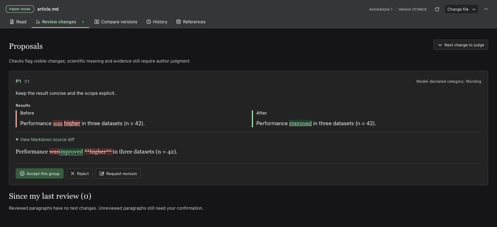

*Screenshots use fictional manuscripts; proposals include real model runs.*

### Automatic updates

After installing **1.0.1**, open **Paper → 插件更新** and enable **自动更新文章审阅插件** once. It is off by default. The independent helper checks at startup and every six hours, downloads only a newer npm release compatible with the installed DSH, verifies its SHA-512 checksum, waits for DSH to exit, and activates it on the next launch. Manuscripts, review records, sessions and model settings stay in place.

Supported schedulers: Windows current-user Task Scheduler (no elevation), macOS LaunchAgent, and Linux user systemd. The account must be logged in / have its user service running, and the captured Node/DSH runtime and npm network access must remain available. Turning the setting off removes the scheduled job. Existing users need to install this release once before the switch becomes available.

## What you can do

**Manuscript review** — available now (`1.0.1`)

- **You open** one Markdown manuscript. PDF, Word and LaTeX are converted to a Markdown copy first.
- **You use it to** annotate, ask the AI for edits, accept or reject word-level changes, and track what you have reviewed.
- **You get back** the Markdown file, edited where you accepted changes. There is no export to Word or LaTeX: carry accepted changes into your original yourself.
- **Needs** any model you use in DSH. Interface in English or Chinese.

**Paper projects** — available now (`1.0.1`)

- **You open** a paper you already have (PDF, Word, LaTeX or Markdown); the agent builds a project from it.
- **You use it to** see the argument as a map (the main claim, the storyline section by section, the claims under it, and the evidence and figure panels behind each), get comments from simulated editors, reviewers and readers, and read with figures beside the text.
- **You get back** a project folder with the map, comments and rewrite drafts. Your original files are never changed, and nothing is exported back to Word or LaTeX.
- **Needs** a model that can read images; time and model usage grow with length (a 4-page paper took about 12 minutes, a 45-page paper about an hour). Interface in Chinese.

<a id="installation"></a>
## Install

**Requirements:** DSH Desktop (`0.2.0-rc.2` to `0.2.2-alpha.2`, including `0.2.1-rc.5`; runtime included) or DSH Web (`0.2.1-alpha.4`; DSH `0.2.2-alpha.2` on the web needs Node.js 24.9+). To import PDF, Word or LaTeX, install [`uv`](https://docs.astral.sh/uv/getting-started/installation/) once yourself; on first use it downloads Python with the PyMuPDF, Pandoc and Pillow packages (about 100 MB) into the workspace's `.paper-tools/` folder, so that first import needs network access. Nothing is installed into your system Python. The plugin uses your existing model configuration.

**Desktop app**

1. Open **Plugins** in the app's left sidebar and click **Add plugin**.
2. Paste the package name `dsh-article-review`.
3. Click **Enable now** and follow any restart prompt.
4. Open a conversation in a local workspace (a folder on your computer) and choose the panel in the right sidebar.

**Web**

```sh
dsh plugin --profile web add dsh-article-review
dsh web
```

Restart a running Web profile after installation.

<details>
<summary>Other installation options and troubleshooting</summary>

- **Today's release:** the registry's `latest` tag points to `1.0.1`. pnpm 11 waits 24 hours before installing a new release by its bare name; to install it today, use `dsh-article-review@1.0.1` or the [package-only opt-in](docs/installation-channels.md).
- **Mirror or GitHub:** you can use the official npm registry or the mainland China mirror (switch back to the official registry if the mirror has not synced). GitHub installation is `github:Biogod2020/dsh-article-review#v1.0.1`. If GitHub times out, download the [prebuilt release archive](https://codeload.github.com/Biogod2020/dsh-article-review/tar.gz/refs/tags/v1.0.1) and enter its absolute local path in **Plugins → Add plugin**, without extracting or building it. Use a prebuilt tag; `main` contains development source.
- **Desktop and Web are separate:** Desktop uses its own `desktop` profile, so installing into `web` does not install into the app.
- **Earlier package name:** this plugin was first developed as `@deepseek-ai/dsh-experimental-paper-review` (tags up to `v0.2.1-alpha.1`). If you installed that package, uninstall it in Plugins before installing `dsh-article-review` and restart. Review records in `.paper-review/` are kept.
- **Platforms:** macOS Desktop and Linux Web have been exercised. For Windows, see [platform requirements](docs/development.md#scope-and-compatibility). Earlier supported DSH versions need Node.js 22.19+ or 24+.

</details>

## Manuscript review

1. Choose **Read, annotate and revise** in the right sidebar and open a Markdown manuscript from the workspace (on Desktop, **Browse workspace → Choose local file** opens the system file dialog; the file must be inside the conversation's workspace). To start from a PDF, Word, LaTeX or pasted text, choose **Import article** in the reader's file controls, or type the import command `/paper-project-start` in the conversation (despite its name, it only imports the article for manuscript review and does not create a paper project); the converted Markdown copy opens in the reader and your original is kept.
2. Select text, annotate it, attach the notes to the conversation and send your request.
3. In **Review changes**, accept, reject or request a revision of each proposal; check the result and mark it reviewed.

Accepting a proposal updates the Markdown file. Each paragraph stays compared with **the last version you marked reviewed**, so later changes stand out. Review records live in `.paper-review/` next to the manuscript: back it up with the manuscript and keep it out of public Git history. See the [user guide](docs/user-guide.md) for figures, references and versions.

<details>
<summary>More screenshots</summary>

<table>
<tr>
<td width="50%">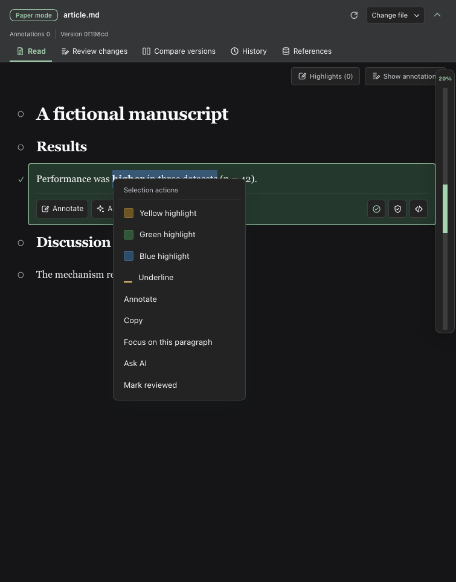<br><sub>Select text and right-click to highlight or annotate.</sub></td>
<td width="50%">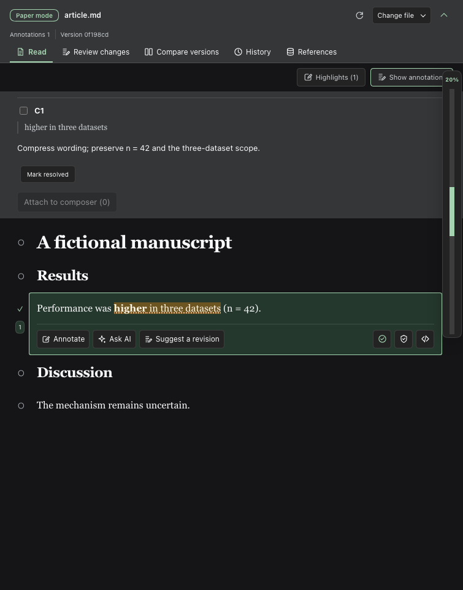<br><sub>Save annotations and attach revision requests to the conversation.</sub></td>
</tr>
<tr>
<td>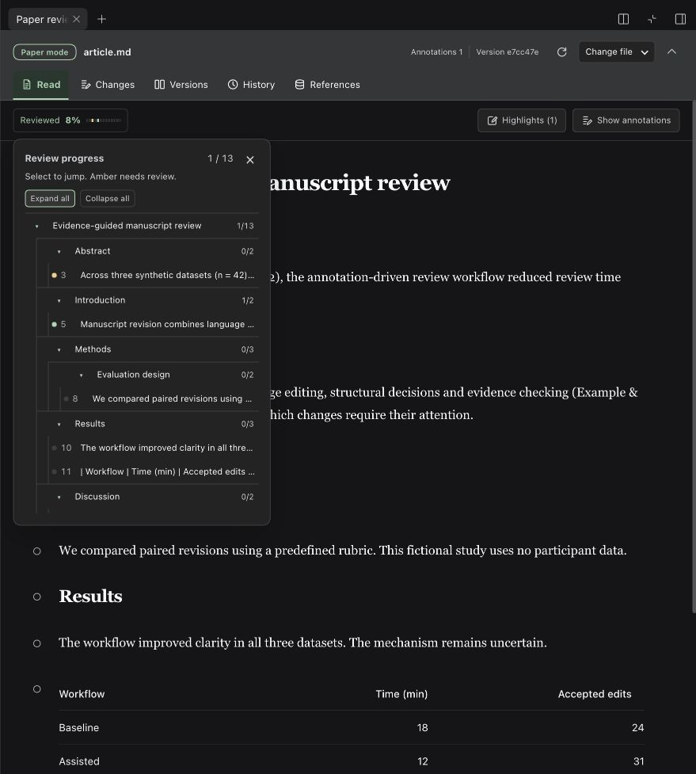<br><sub>Check review progress and jump to sections or paragraphs.</sub></td>
<td>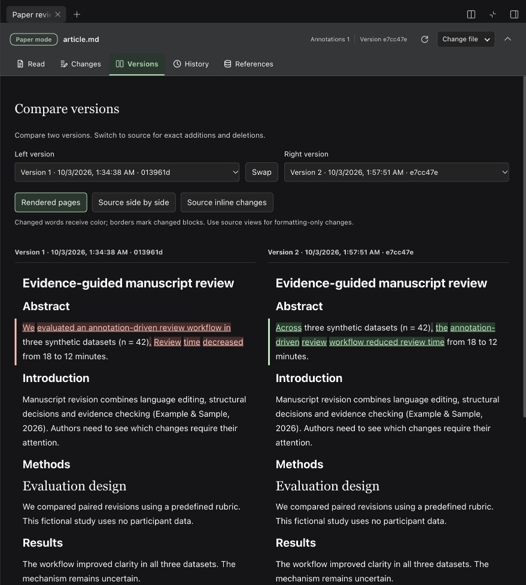<br><sub>Compare two versions and see changed words directly.</sub></td>
</tr>
<tr>
<td>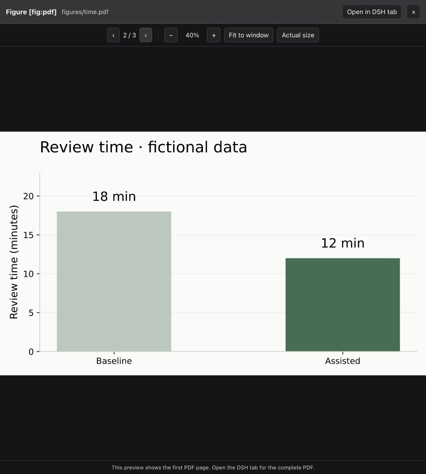<br><sub>Preview PDF figures.</sub></td>
<td>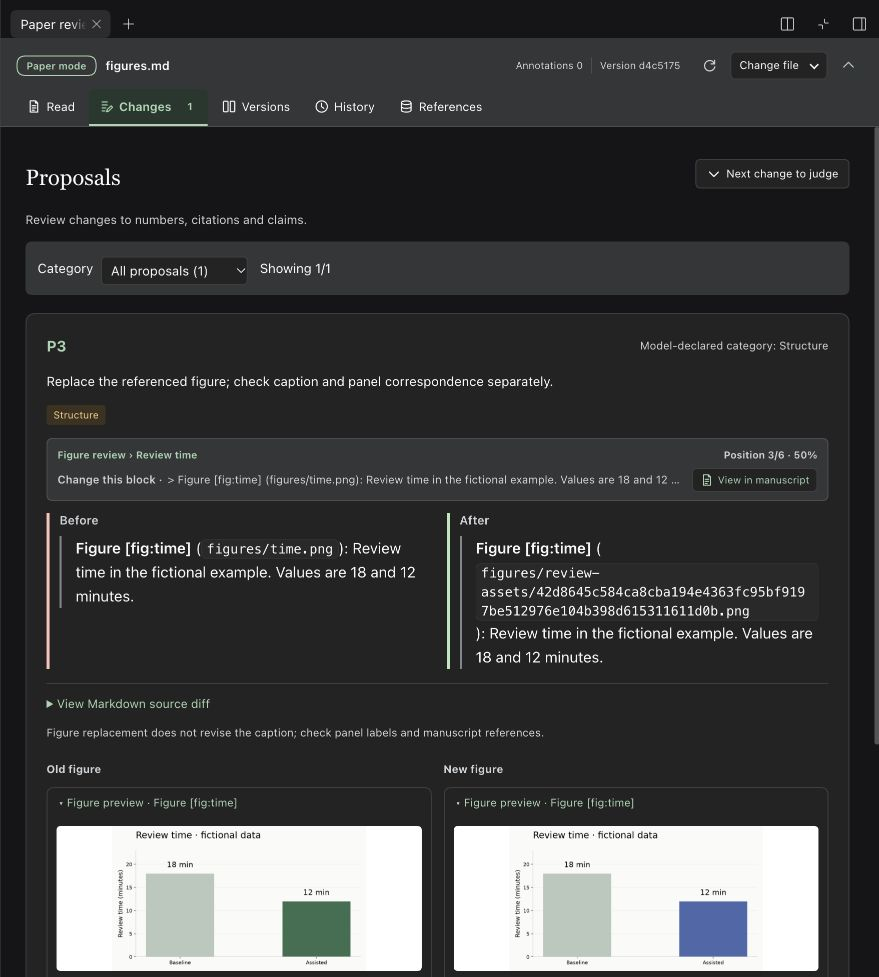<br><sub>Review figure replacements before and after.</sub></td>
</tr>
<tr>
<td>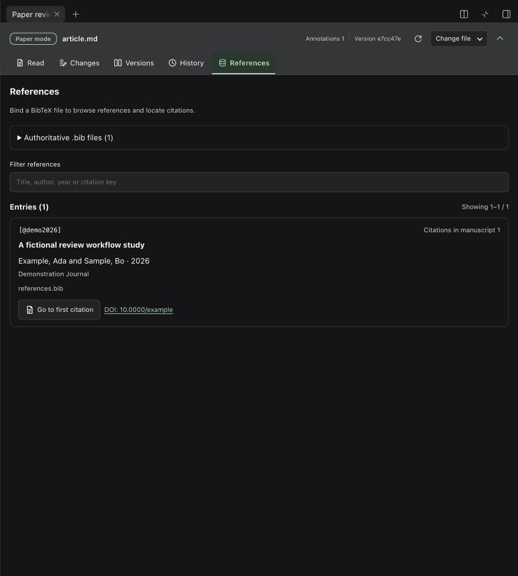<br><sub>Browse references and check citation keys.</sub></td>
<td>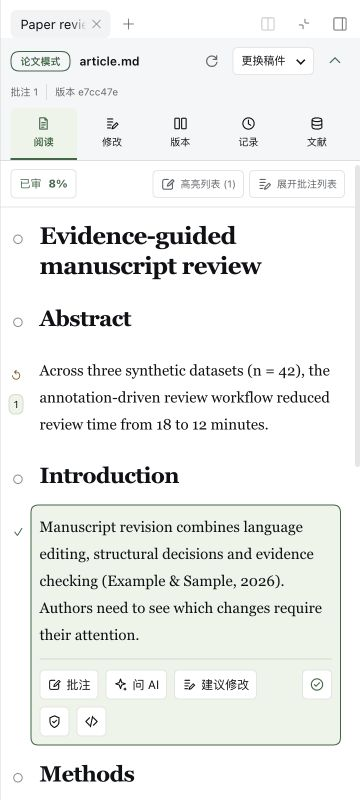<br><sub>Compact reading on narrow screens.</sub></td>
</tr>
</table>

</details>

## Paper projects (next release)

Paper projects are on `main` and will be in the next npm release; the current release does not include them. The project panel's interface is in Chinese.

Choose **Paper** (论文) in the right sidebar and start from a paper you already have:

1. Enter the manuscript, and optionally its figure folder, existing comments and the research repository it comes from. The panel proposes a project folder inside the workspace and checks every path before starting.
2. Choose **交给 agent 初始化** (Hand to agent). The agent reads the paper page by page and copies the text into the project, cuts out each figure and its panels (the lettered parts a, b, c) by looking at the page, maps the argument, and finally checks its copy against your file and fixes what it missed. It runs as tasks in the current DSH conversation: the panel shows progress and can pause, resume or stop, and typing in that conversation pauses it.
3. Work in the project:
   - **Story map (故事流):** the main claim, the storyline section by section, and the claims under it, each with the evidence and figure panels behind it. Mark items reviewed; later changes are flagged.
   - **Read (阅读):** the text in pages, with the figure panels each page cites beside it.
   - **Comments and drafts:** you and simulated editors, reviewers and readers comment; the agent revises claims and figures directly and proposes paragraph rewrites as drafts you accept or discard.

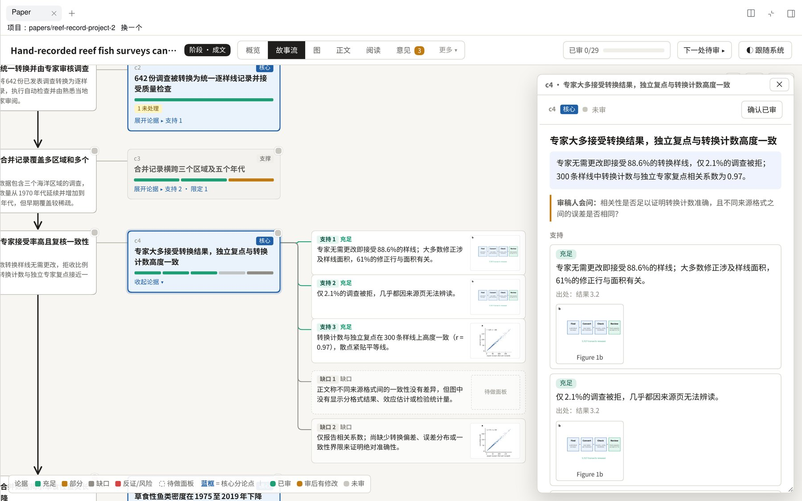

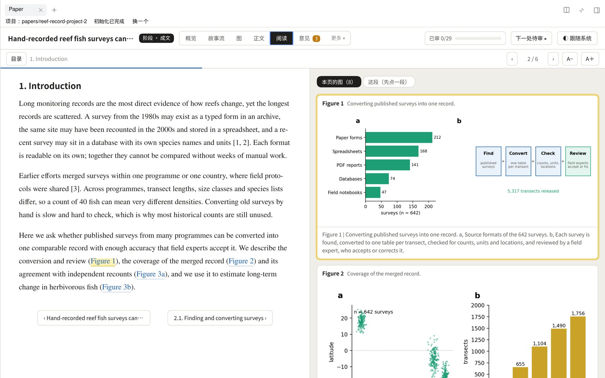

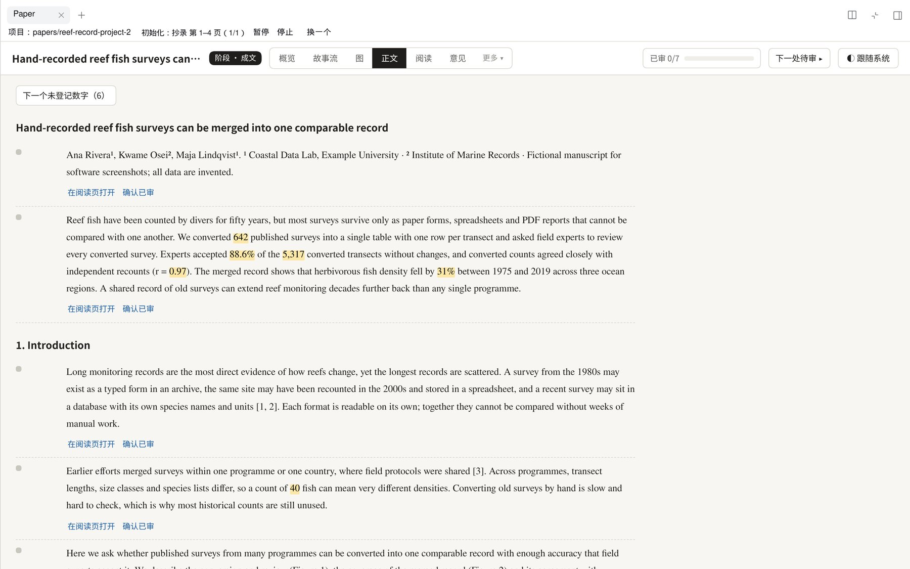

See the [paper projects guide](docs/user-guide.md#paper-projects-preview) for the steps, the files a project contains, and what changes are made directly or as drafts.

## Documentation

- [User guide](docs/user-guide.md) — manuscript review, figures, references, configuration and paper projects.
- [Development and compatibility](docs/development.md) — builds, releases, tools and persistence.
- [Project mode design notes](docs/project-mode.zh.md) — how paper projects work inside (Chinese).

[MIT License](LICENSE)
