# DSH Article Review

[English](README.md) | 中文

这是 [DSH（DeepSeek Harness）](https://github.com/deepseek-ai/deepseek-harness) 的学术写作插件。DSH 是在你自己电脑上运行的 AI agent 应用，有桌面版和网页版；使用本插件前请先按 [DSH 的说明](https://github.com/deepseek-ai/deepseek-harness#readme)安装 DSH。插件在 DSH 对话旁边加一个面板，你和 AI 在里面一起改论文：你阅读、批注，AI 提出修改，接不接受由你决定。

**数据去向：** 稿件和审阅记录都保存在你电脑上当前对话的工作区文件夹里。文字只发给你在 DSH 里配置的模型；插件本身不连接任何其他服务。如果未发表的内容不能离开你的电脑，请在 DSH 里配置本地模型。

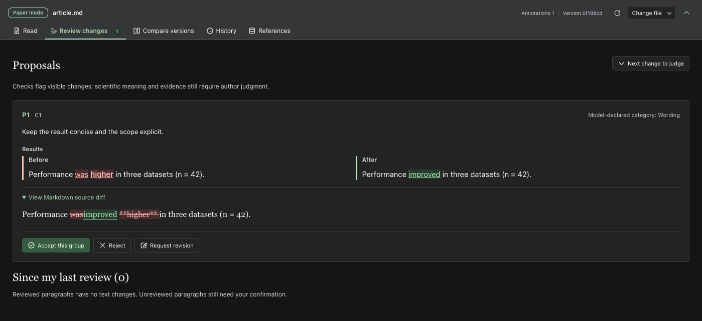

*截图使用虚构稿件，含真实模型提案。*

## 能做什么

**稿件审阅**：现在可用（`1.0.2`）

- **打开：** 一份 Markdown 稿件。PDF、Word、LaTeX 会先转成一份 Markdown 副本。
- **用途：** 批注、让 AI 修改、逐词接受或拒绝改动，并记录哪些已经审过。
- **得到：** 改好的 Markdown 文件（只改你接受的地方）。不能导出成 Word 或 LaTeX，接受的修改需要你自己改回原稿。
- **需要：** 你在 DSH 里用的任何模型。界面有中文和英文。

**论文项目**：现在可用（`1.0.2`）

- **打开：** 你已有的论文（PDF、Word、LaTeX 或 Markdown），由 agent 建成项目。
- **用途：** 把论证画成一张图（核心论点、按顺序的叙事主线、其下的分论点，以及每个分论点背后的论据和图表面板），让模拟的编辑、审稿人、读者提意见，对照图表阅读。
- **得到：** 一个项目文件夹，里面有论证图、意见和改写草稿。原始文件不会被改动，也不会导出回 Word 或 LaTeX。
- **需要：** 能看图的模型；用时和模型用量随篇幅增加（4 页的论文约 12 分钟，45 页约 1 小时）。界面只有中文。

<a id="installation"></a>
## 安装

**需要：** DSH 桌面版（`0.2.0-rc.2` 至 `0.2.2-alpha.2`，含 `0.2.1-rc.5`，自带运行环境）或 DSH 网页版（`0.2.1-alpha.4`；网页版的 DSH `0.2.2-alpha.2` 需要 Node.js 24.9+）。要导入 PDF、Word 或 LaTeX，请先自己安装一次 [`uv`](https://docs.astral.sh/uv/getting-started/installation/)；第一次导入时它会把 Python 和 PyMuPDF、Pandoc、Pillow 这几个包（约 100 MB）下载到工作区的 `.paper-tools/` 文件夹，所以需要联网；不会改动你系统里的 Python。插件沿用你现有的模型配置。

**桌面版**

1. 在 App 左侧打开 **Plugins（插件）**，点击 **Add plugin（添加插件）**。
2. 粘贴包名 `dsh-article-review`。
3. 点击 **Enable now（立即启用）**，按提示重启。
4. 在本地工作区（你电脑上的一个文件夹）打开一个对话，在右侧栏选择面板。

**网页版**

```sh
dsh plugin --profile web add dsh-article-review
dsh web
```

安装后重启正在运行的 Web。

<details>
<summary>其他安装方式与常见问题</summary>

- **当天发布的版本：** 注册表 `latest` 指向 `1.0.2`。pnpm 11 对新版本有 24 小时观察期，期间按包名安装可能装到旧版；当天要装新版，请填 `dsh-article-review@1.0.2`，或按[说明仅对此包允许即时安装](docs/installation-channels.md#中文)。
- **镜像或 GitHub：** 可以用 npm 官方源或中国大陆镜像（镜像没同步时切回官方源）。GitHub 安装地址是 `github:Biogod2020/dsh-article-review#v1.0.2`。GitHub 连接超时时，可以下载[预构建发行归档](https://codeload.github.com/Biogod2020/dsh-article-review/tar.gz/refs/tags/v1.0.2)，在 **Plugins → Add plugin** 中输入归档的本地绝对路径，无需解压或构建。请使用预构建 tag；`main` 是开发源码。
- **桌面版和网页版分开安装：** 桌面版使用自己的 `desktop` 配置，装到 `web` 不会同时装到 App。
- **早期包名：** 这个插件最早以 `@deepseek-ai/dsh-experimental-paper-review` 开发（`v0.2.1-alpha.1` 及更早的 tag）。装过旧包的话，先在 Plugins 中卸载旧包，再安装 `dsh-article-review` 并重启；`.paper-review/` 里的审阅记录继续使用。
- **平台：** macOS 桌面版和 Linux 网页版已实测。Windows 要求见[支持范围与兼容性](docs/development.zh.md#scope-and-compatibility)。此前支持的 DSH 版本需要 Node.js 22.19+ 或 24+。

</details>

## 稿件审阅

1. 在右侧栏选择**阅读、批注与局部修改**，打开工作区里的 Markdown 稿件（桌面版点**浏览工作区 → 选择本地文件**会打开系统选择窗口，文件必须在当前对话的工作区内）。要从 PDF、Word、LaTeX 或粘贴的文字开始，在阅读器文件操作区点击**导入文章**，或在对话中输入导入命令 `/paper-project-start`（名字里虽有 project，它只是为稿件审阅导入文章，不会建立论文项目）；转换后的 Markdown 副本会在阅读器中打开，原稿保留不动。
2. 选中文字写批注，把批注附到对话里，发出修改要求。
3. 在**审阅修改**中逐条接受、拒绝或要求重写；核对结果后标为已审。

接受提案会更新 Markdown 文件。每段都对照**你最后标为已审的版本**，之后的改动一目了然。审阅记录保存在稿件旁的 `.paper-review/` 里：请和稿件一起备份，不要放进公开的 Git 历史。图表、文献和版本对比见[使用指南](docs/user-guide.zh.md)。

<details>
<summary>更多截图</summary>

<table>
<tr>
<td width="50%">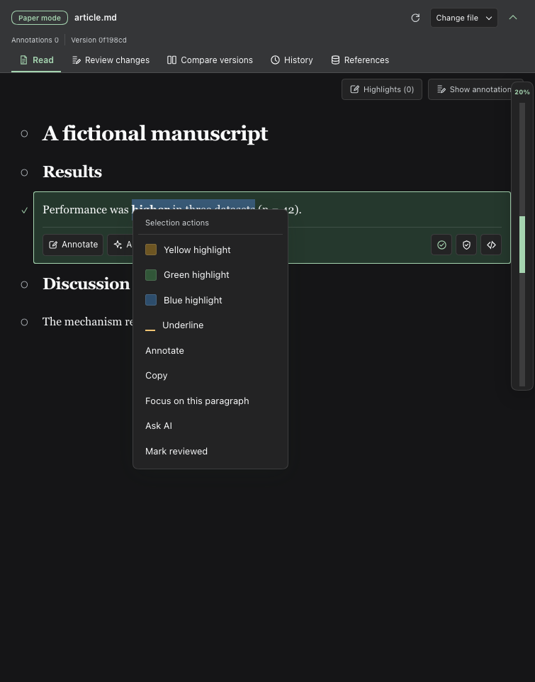<br><sub>选中文字后右键，可以高亮或批注。</sub></td>
<td width="50%">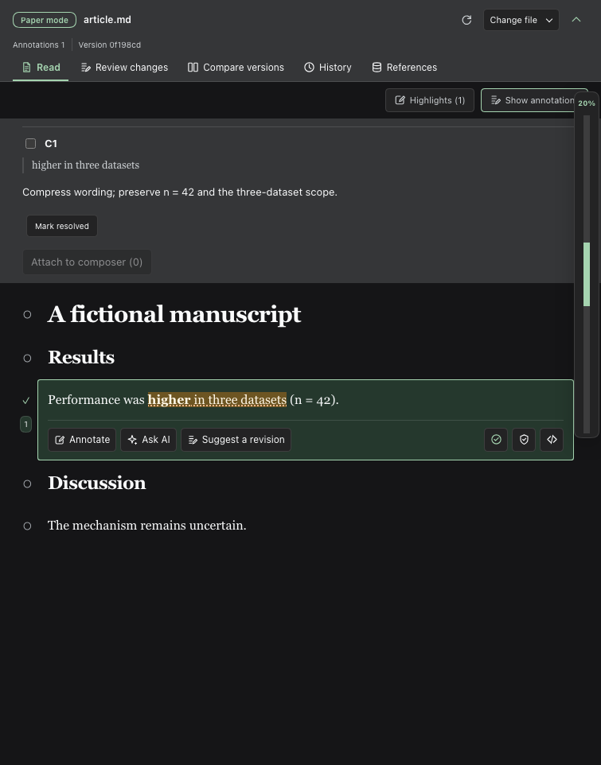<br><sub>保存批注，并把修改要求附到对话里。</sub></td>
</tr>
<tr>
<td>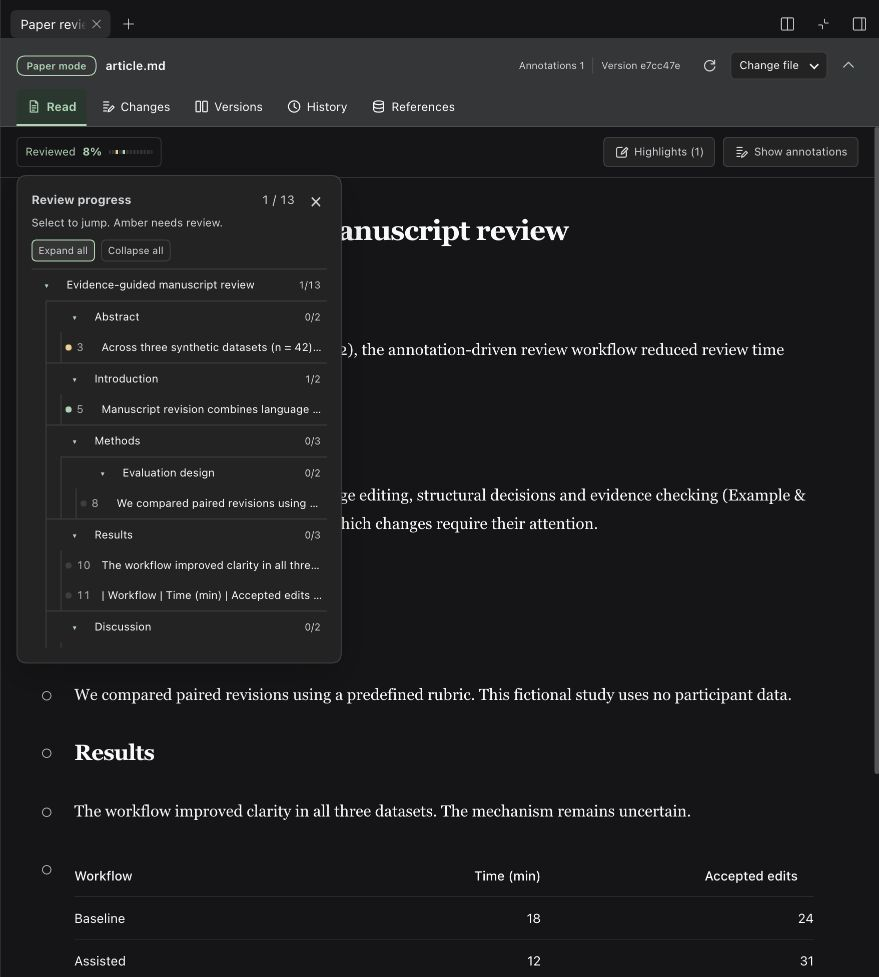<br><sub>查看审阅进度，跳到小节或段落。</sub></td>
<td>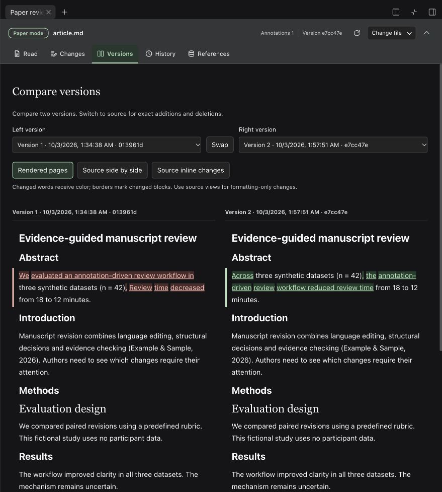<br><sub>对比两个版本，直接看到改了哪些词。</sub></td>
</tr>
<tr>
<td>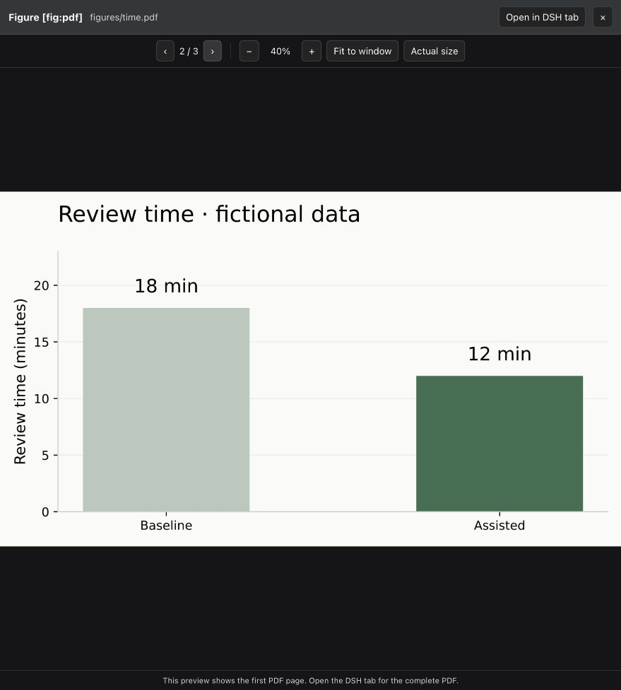<br><sub>预览 PDF 图。</sub></td>
<td>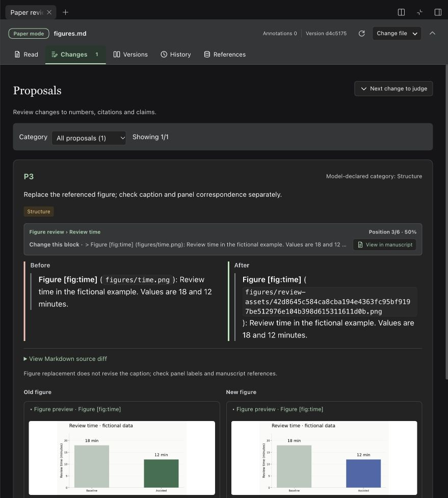<br><sub>对照换图前后。</sub></td>
</tr>
<tr>
<td>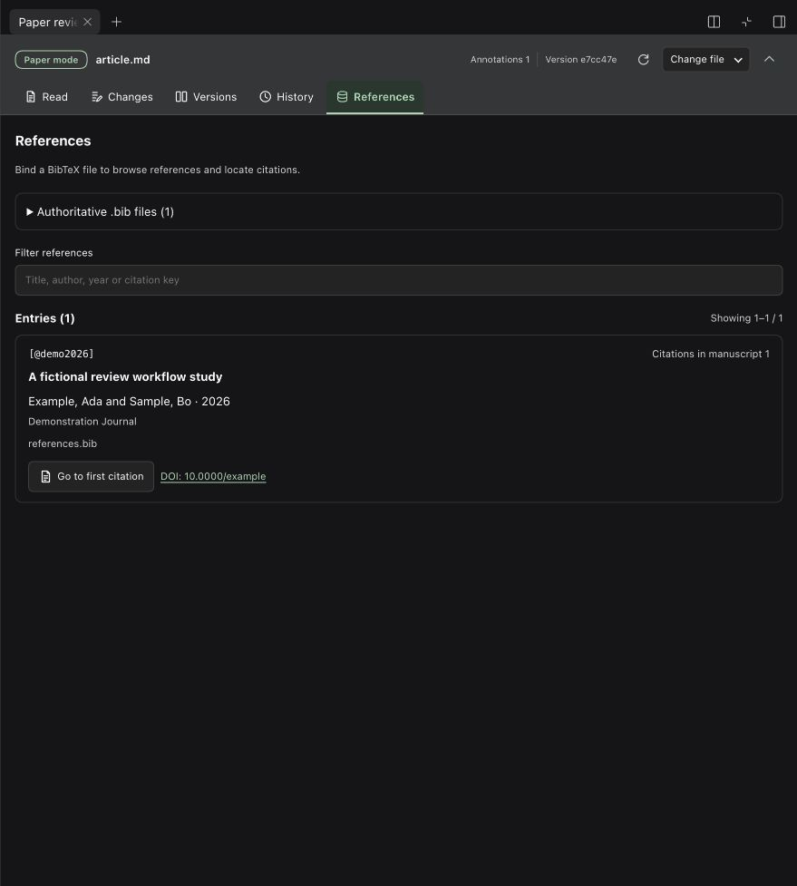<br><sub>浏览文献，检查引用键。</sub></td>
<td>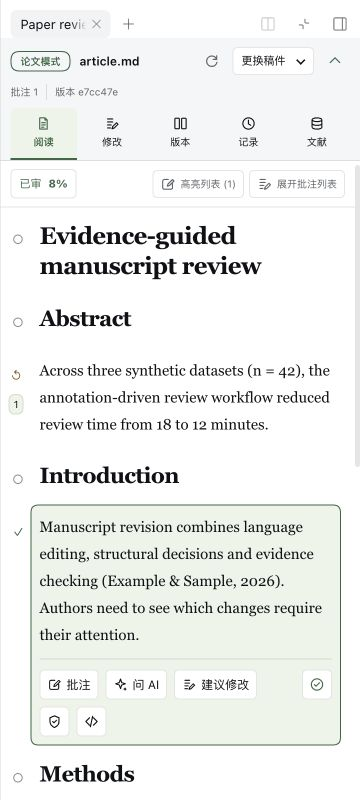<br><sub>窄屏下的紧凑阅读。</sub></td>
</tr>
</table>

</details>

## 论文项目（下一个版本）

论文项目已经在 `main` 上，会随下一个 npm 版本发布；当前版本还没有。项目面板目前只有中文界面。

在右侧栏选择**论文**，从你已有的论文开始：

1. 填稿件，可以再填图所在的文件夹、已有意见，以及论文所在的研究仓库。面板会在工作区里给出一个项目文件夹，开始前检查所有路径。
2. 点**交给 agent 初始化**。agent 逐页阅读论文，把正文抄进项目；看着页面裁出每张图和它的各个分图（a、b、c）；整理出论证；最后对照你的原稿检查自己的抄录，并补上漏掉的地方。它在当前 DSH 对话中作为任务运行：面板显示进度，可以暂停、继续或停止；在这个对话里打字也会让它暂停。
3. 在项目里工作：
   - **故事流：** 核心论点、按顺序的叙事主线和其下的分论点，每个分论点下是论据和图表面板。可以标为已审，之后的改动会标出来。
   - **阅读：** 正文分页显示，每页旁边是这一页引用的图表面板。
   - **意见与草稿：** 你和模拟的编辑、审稿人、读者都可以写意见；agent 直接修改分论点和图，段落改写以草稿形式等你接受或放弃。

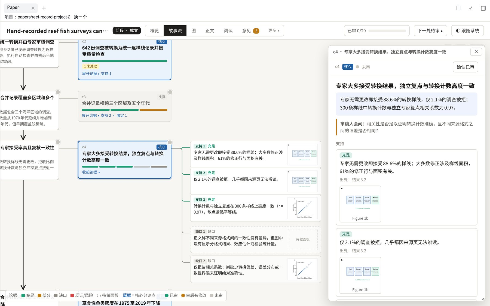

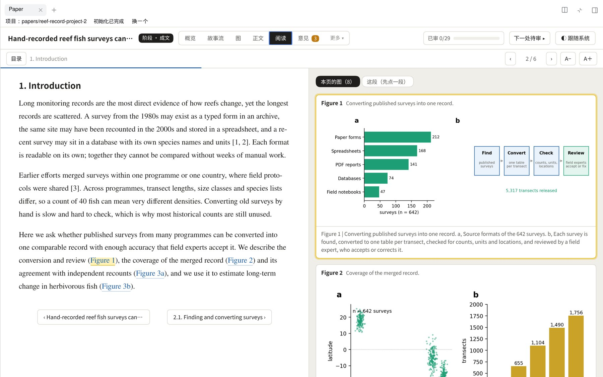

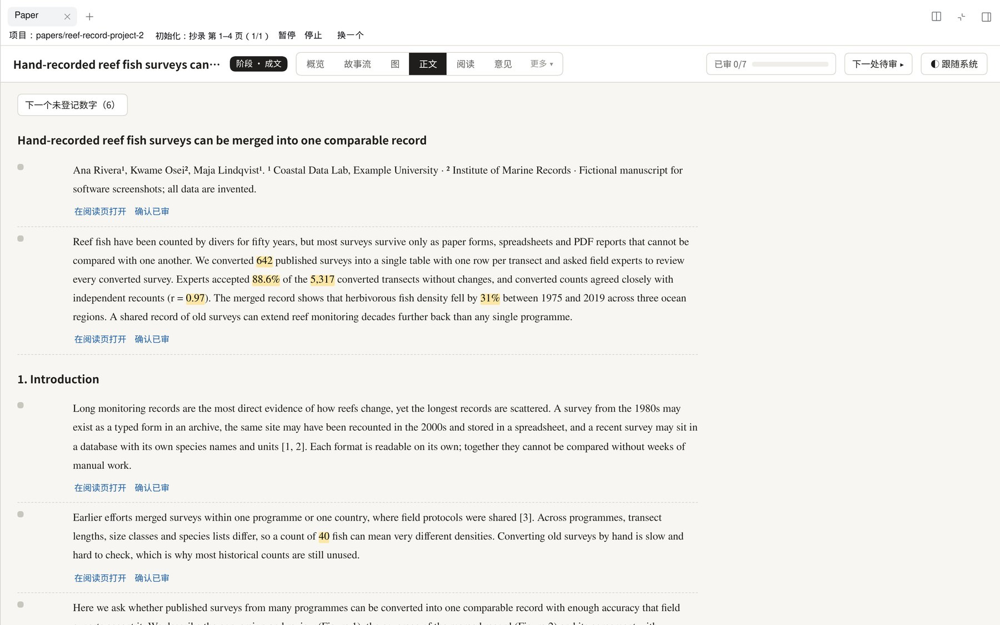

具体步骤、项目里有哪些文件、哪些修改直接生效、哪些以草稿形式等你确认，见[论文项目指南](docs/user-guide.zh.md#论文项目预览)。

## 文档

- [使用指南](docs/user-guide.zh.md)：稿件审阅、图表、文献、配置和论文项目。
- [开发与兼容性](docs/development.zh.md)：构建、发布、工具与持久化。
- [项目模式设计说明](docs/project-mode.zh.md)：论文项目的内部工作方式。

[MIT 许可证](LICENSE)

## 自动更新

安装 **1.0.2** 后，打开 **论文 → 插件更新**，开启 **自动更新文章审阅插件** 一次。默认关闭。支持 Windows 当前用户任务计划（无需管理员权限）、macOS LaunchAgent 和 Linux 用户 systemd。独立更新程序在启动时及每 6 小时检查 npm 上兼容当前 DSH 的新版，验证 SHA-512，等待 DSH 退出后安装，下次启动生效。关闭开关会移除计划任务。稿件、审阅记录、会话和模型配置不参与替换。旧版用户需要先手动升级到本版一次。
