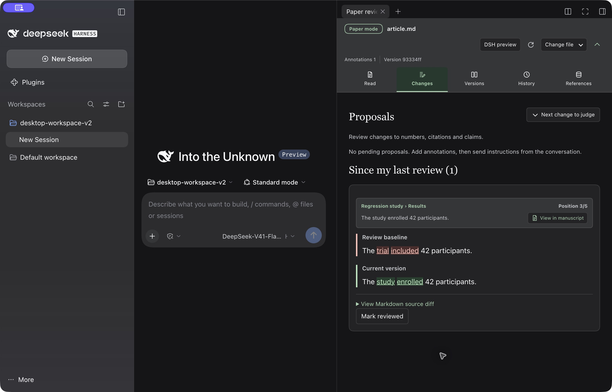
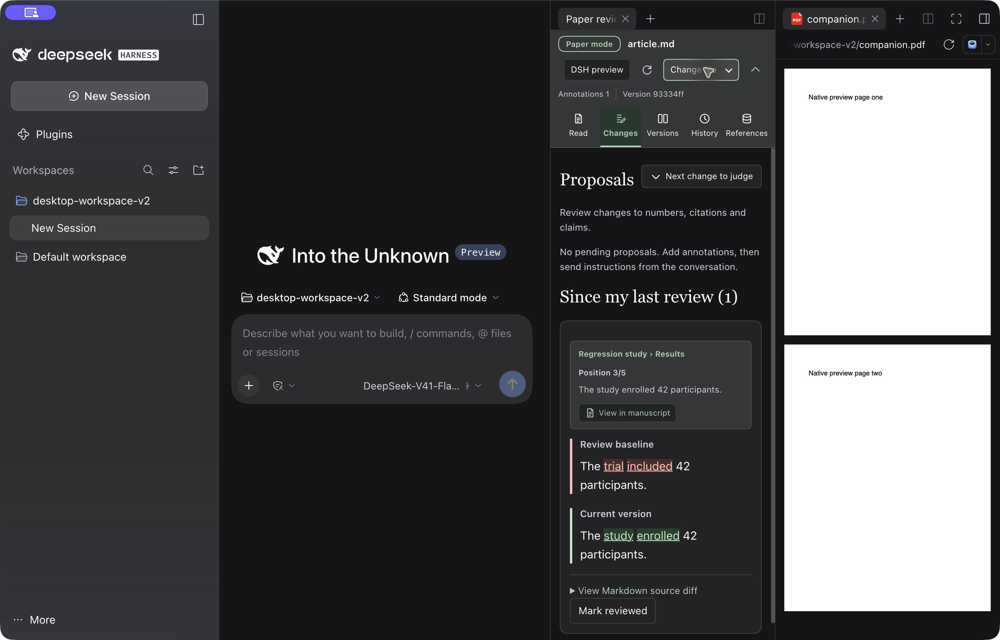

# 0.2.1-alpha.1 验收记录

2026-10-15 · macOS / arm64。

本版适配 DSH `0.2.1-alpha.4`，并保留当前官方 macOS Desktop `0.2.0-rc.2` 的支持。审稿状态仍使用原有 schema 1；未迁移或重置批注、提案、版本与人工基线。LaTeX 编辑不在本版范围内。

## 改动

- 通过 `engines.dsh` 声明两个已验证宿主；发行包的 Cordis 和原生命令依赖允许匹配各自宿主，避免固定拉入旧版原生命令包。
- 使用最新版 DSH 客户端构建接口。`zod` 随插件打包，兼容尚无该共享模块的官方 Desktop；发行准备脚本拒绝遗留的外部 `require("zod")`。
- 增加 **DSH 预览** 和 **预览配套文件**。文件交给官方查看器；审稿仍针对原 Markdown，不接受提案、不重置人工基线。
- 窄审稿栏中的文件操作自动换行，避免配套预览按钮挤出面板。
- CI 增加固定在 `0.2.1-alpha.4` 发行包上的完整宿主、客户端与组合测试。

## 自动检查

| 环境 | 结果 |
|---|---|
| DSH `0.2.0-rc.2` 源码宿主 | 宿主/客户端类型检查，38 文件、240 项通过 |
| DSH `0.2.1-alpha.4` 已发布运行时 | 宿主/客户端类型检查，38 文件、240 项通过 |
| 独立便携检查 | 18 文件、87 项及核心类型检查通过 |

新版 JSONL 持久化包改为命名插件导出；测试组合同时处理旧服务类和新插件形式，快照未放宽。最新版已发布 UI 包缺少 sourcemap 会产生 Vite 提示，不影响测试执行。

## Desktop 实测

在官方 Desktop `0.2.0-rc.2` 的隔离副本中运行最终候选包，使用独立用户数据、配置、工作区与系统分配的端口。未修改日常 App 安装或真实稿件，未配置模型凭据或发出真实模型请求。

| 操作 | 观察结果 |
|---|---|
| 系统选择稿件 | 取消后可重试，选择工作区内 Markdown 后正常打开 |
| 接受和拒绝 | P2 接受并写入正文；P3 拒绝，未写入其不受支持的论断 |
| 累计人工基线 | 接受两轮后，当前文字为 `The study enrolled 42 participants.`，基线仍为 `The trial included 42 participants.`；持久化基线对象逐字段未变 |
| 批注与输入框 | C1 保留；选中后附入原生输入框，没有自动发送；重启后草稿恢复 |
| 版本与文献 | 三个版本可比较、交换和查看源码差异；BibTeX 绑定后显示虚构条目 |
| 重启恢复 | 完整退出并重启后，审稿页、人工基线、批注、已处理提案和文献绑定恢复 |
| 官方预览 | Markdown 正文、含可选文字的双页 PDF、DOCX 经本地转换后的 PDF 均正常显示；原审稿页仍保留 |

Windows Desktop 未实机验收。集成用例使用脚本化模型响应；本次验证不评估真实模型的修稿质量。原生预览继承 DSH 的格式、转换依赖和两栏布局限制。
