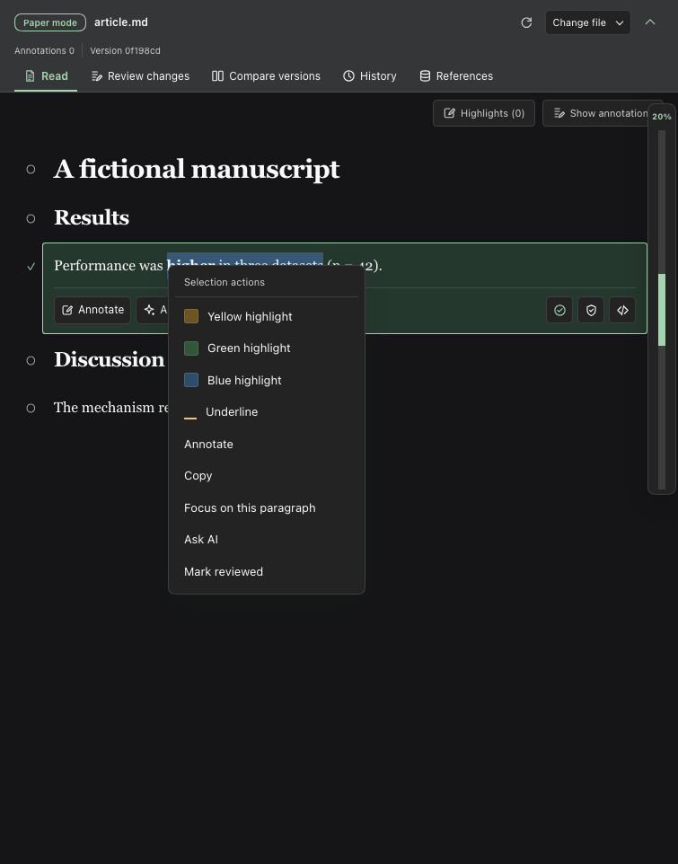
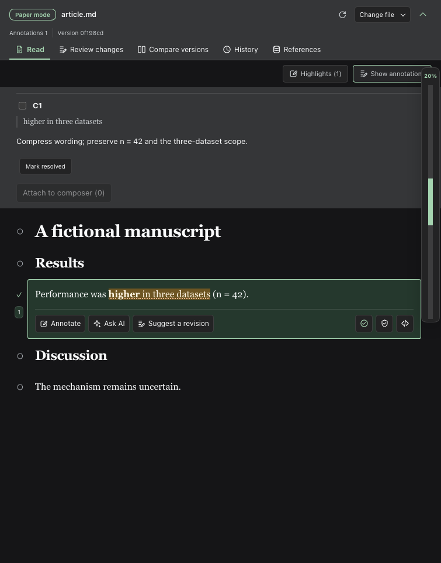
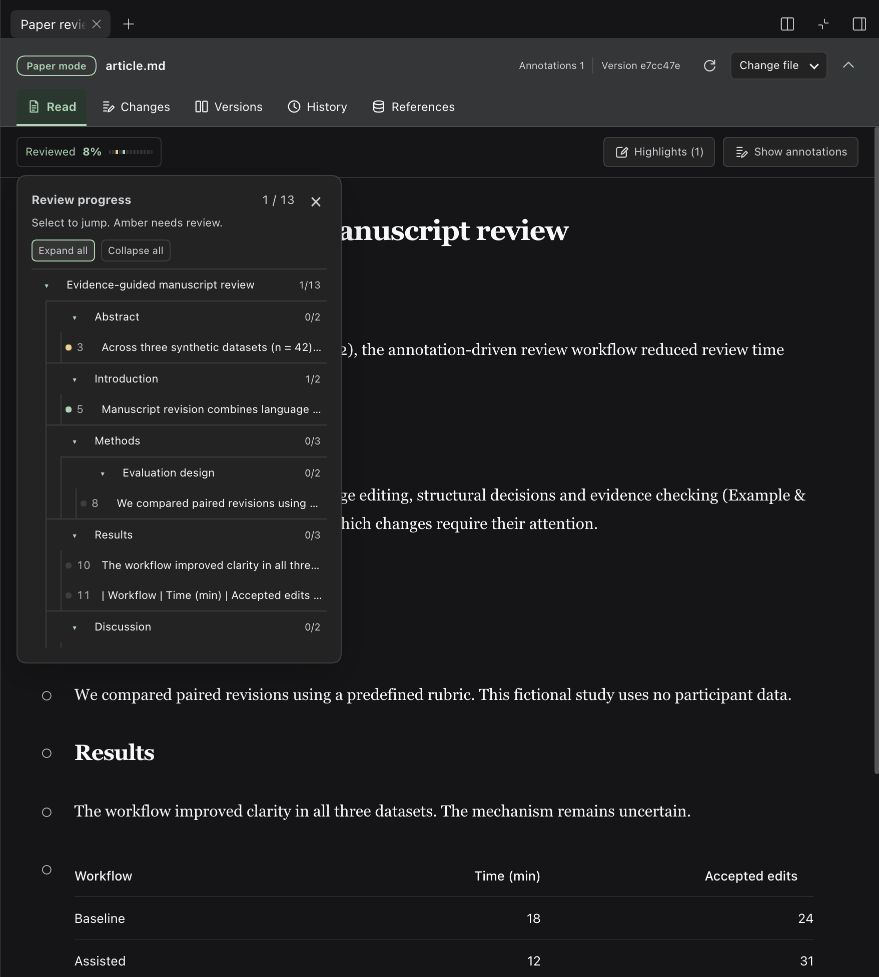
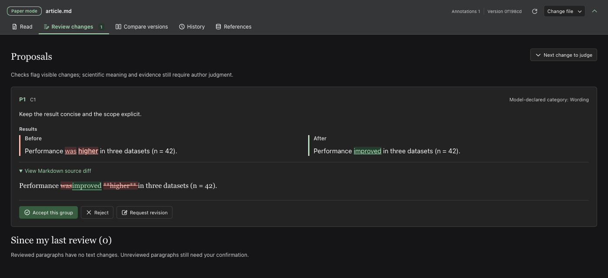
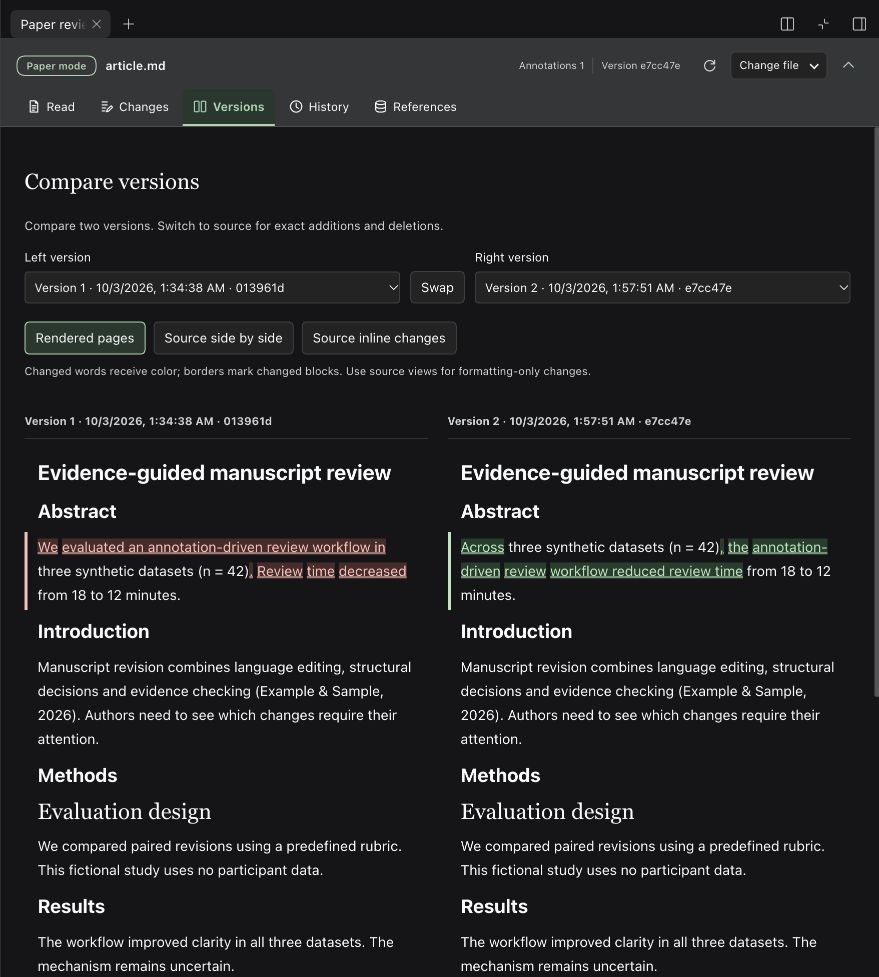

# User guide

## Start from an article

In the reader's file controls, choose **Import article**, enter a source path or paste exact prose, then choose **Import and read**. `/paper-project-start` provides the same workflow from the conversation. It accepts PDF, DOCX, LaTeX, Markdown, TXT, HTML, RTF and ODT; other readable text extensions follow the text path. Use this conversation's workspace for generated projects. The original input stays unchanged.

The fixed skill runs a bundled normalizer, opens the generated `article.md`, and prepares local figures only when artwork exists. Captions without images remain text. Scans need OCR and visual verification; uncertain conversion or panel links are reported. The first run requires `uv` and network access to prepare pinned Python tools in `.paper-tools/`; later calls reuse them. No system Python installation is modified. Each imported project retains source bytes and `import.json` provenance, and an edited existing import is never overwritten.

An explicit agent `paper_open` reveals the reader only in that conversation when it is active. Existing document positions and unsent composer drafts are retained; background tasks do not switch another conversation's reader.

## Text, figures and section pages

In **Read**, choose **Reading layout → Text and figures** and **Navigation → By section** independently. Figures start **On demand**: a subtle underline on printed figure references identifies related artwork without narrowing or moving the prose. Hover or focus a printed reference such as **Figure 1a** or **Fig. 1a** to preview it; click to open a persistent floating window. You can also drag the preview title or resize any edge or corner directly: it becomes a persistent window without jumping away. Arrow keys work on the title and lower-right handle. Later previews reuse the dimensions you chose, bounded by the reading area. Escape closes it. Touch users can open the same window by tapping. **Dock to reading area** turns it into a fixed comparison, and **Float figure window** brings it back. **Reading tools → Figure display** also selects these modes. Window geometry, image views and the current paragraph are saved locally.

In docked view, wide diagrams automatically use the full reading width above the text; square and tall figures use side-by-side columns. Narrow panes place all figures above the text. Both surfaces scroll independently. Layout changes, navigation changes and reloads restore the current paragraph and relative position within it.

The compact toolbar keeps layout, navigation and review progress visible. **Reading tools** contains highlights, annotations, review jumps, focus reading and column balance. It also contains **AI: split and link panels** in every reading layout. Click outside the tools or press Escape to close them. File controls hold the document version and annotation count.

Select a **Whole figure** or an associated panel. Explicit body callouts and saved panel associations select the related image; printed figure references open it directly, without an extra row of figure buttons. **Pin figure** keeps the image while you continue reading; **Follow text** resumes automatic selection. Zoom, drag to pan, or open the image full screen. **Locate related text** opens its exact paragraph and switches section pages when needed.

Use the **Whole figure / a / b / …** buttons to inspect a panel in context, and the arrow buttons to move to the previous or next figure. The figure selector lists only parent figures, keeping it short even when many panels exist. **Fit to width** gives tall figures room to scroll; **Fit to window** shows the complete image. Zoom keeps the area at the center of the image in view. Each image remembers its fit, zoom and pan, including when the panel is reopened. The size display shows the fitting mode at its default size, or the actual displayed pixel percentage when zoomed. Expand **Figure caption** to read the source caption beside the image. When a panel has several related paragraphs, each click on **Locate related text** visits the next one.

Drag the divider or use its arrow keys to resize side-by-side columns; double-click to reset. **Reading tools → Figure placement** overrides the automatic layout with **Side by side** or **Above text**. **Column balance** also offers preset proportions. Narrow panes offer **Collapse image** to free space for the manuscript, while keeping the selected figure visible in the heading. Column balance and the collapsed state are remembered with your reading position.

Click **AI: split and link panels** to load the bundled [paper-figure-panels skill](../skills/paper-figure-panels/SKILL.md) and start a task in the current DSH conversation without changing the unsent input draft. The AI inspects the actual artwork, caption and body text, creates panel crops and associates them with exact paragraphs. The button is disabled while a response runs; DSH's ordinary stop control can stop the task. The configured model and tools must support image inspection and local script execution; the helper uses `uv` with temporary Pillow and PyMuPDF dependencies. Uncertain panels stay as whole figures with an explanation rather than guessed associations.

For multiple figures, the skill can use 2–3 available native workers with separate figure assignments and reuse still-valid saved panels. Bundled coordinate grids and crop contact sheets support visual checks; prepared JSON files keep exact paragraph text out of repeated model calls. Dependency helpers ignore unrelated Python project environments.

Preparation targets the exact manuscript and workspace open in the reader. During that run, the parent conversation cannot open or register panels to a different copy. Context packets and registration files carry workspace identity; helpers reject reuse in another workspace. Completion checks report the actual destination, valid panel count and exact paragraph association count. A figure with no usable map shows **No panels available for this figure** beside **Whole figure**; installing the plugin alone does not create panel maps.

Crops and associations are saved in the workspace without editing manuscript prose, original artwork or human review decisions. The reader checks for updates after the task; **Check updates** also reloads panel metadata. Changed source artwork or paragraphs require reconnecting affected panels. Back up `.paper-review/` and generated `figures/` directories with the manuscript.

The reader distinguishes images linked to the current passage, manual browsing and pinned images. On-demand mode leaves unassociated sections unobstructed. In docked view, sections without associations collapse to a compact notice; **Browse figures** deliberately opens the previous image. Changing sections resumes following text unless the image is pinned.

A single compact section selector and previous/next arrows share the reading toolbar. The end of a section has only a lightweight next-section link. Section pages follow Markdown headings and keep paragraphs, tables and lists whole. Use **Previous section**, **Next section** or the section selector. Manuscript search, outline, annotations, proposals and citation navigation still locate targets across pages.

## Native document previews

Click **DSH preview** to inspect the current manuscript file on disk, or **Change file → Preview companion files** to open another workspace file with DSH’s native renderer. Markdown, PDF, images and Office use the viewers supplied by your DSH installation. Office conversion requires its local rendering runtime.

The preview requests a second pane when space permits. DSH has a two-pane limit; with both panes occupied it may open another tab. The review tab, annotations and human baselines remain available. Previewing does not switch the selected review manuscript or accept changes. A file changed externally can show newer content in native preview while the review remains on its pinned version; use **Load new version** in the review when ready.

English | [中文](user-guide.zh.md)

This guide covers file selection, annotations, proposals, version comparison, figures and references. For installation, see the [project README](../README.md#installation).

## Configuration

The default manuscript directory is the current conversation's local workspace. Stored conversations can reopen manuscripts after a server restart without sending a model message. Optional profile overrides target the `paper-review` row. The [review overlay](../review.overlay.yml) remains available for isolated development with an explicit `DSH_PAPER_REVIEW_ROOT`; it is not needed for native installation.

| Field | Default | Meaning |
|---|---|---|
| `workspaceRoot` | Conversation workspace | Optional fixed local directory containing the manuscripts |
| `maxBytes` | `1000000` | Maximum manuscript UTF-8 bytes; at most `2000000` |
| `maxFigureBytes` | `67108864` | Maximum bytes retained for one replacement figure; 64 MiB by default |

Choose a local workspace and open **Read, annotate and revise** in the right sidebar. **Browse workspace** lists folders and Markdown files on every host; alternatively enter a relative path such as `article.md`. **Choose local file** opens the App's system dialog in Desktop; Web uses the macOS host chooser. Files must stay inside the workspace; symlink escapes are refused. Each directory shows at most 500 entries. The agent can also use `paper_list` and `paper_open`. Selection survives restarts. **Exit Paper mode** retains review records and hides active manuscript tools; it is unavailable while the agent runs.

After opening a manuscript, the header keeps the review tabs visible while hiding file controls. Select **Change file** to reopen the path, picker and exit action; use the toolbar chevron to leave only a narrow manuscript bar while reading. The toolbar choice survives a reload. Each view's position, comparison versions and layout survive view changes and reloads in this browser; returning to **Read** restores the visible paragraph and its offset after lazy rendering. Explicit proposal, outline and search jumps take priority. Navigation and major review decisions pair icons with text; compact controls such as refresh, mark reviewed, lock and source use icons with tooltips and accessible names. Narrow panes keep short text labels below the icons. An opening Markdown provenance comment appears as a collapsed **Manuscript source note** in the reader; expand it to inspect its exact text. These display controls do not edit the manuscript or its review records.

With focus in the review pane, press Cmd+F on macOS or Ctrl+F elsewhere to search the current view: Read, Review changes, Compare versions, History or References. Search reveals lazy or paginated results, highlights mounted matches, and scrolls to the selected occurrence. **Find in full manuscript** switches to Read. Enter, Shift+Enter and the arrow buttons move between matches. Escape closes search and removes temporary highlights without changing the manuscript or saved highlights. Search does not take the shortcut from a text input or another pane. Broad searches stop after 2,000 matches.

## Review workflow

1. Select text within a paragraph and right-click for yellow, green or blue highlights, underlining, annotations, copying, focused reading or AI context. Inline formatting and repeated phrases retain the selected occurrence. Highlights and annotations never change the manuscript. The highlight list offers removal and restoration. Clicking a paragraph still exposes its existing actions.
2. Mark a paragraph reviewed, or review and lock it. This saves the human-review baseline. A lock prevents proposals and acceptance for that block inside this plugin. Marking it reviewed again preserves the lock; only **Unlock** removes it. The sticky reading toolbar shows a compact reviewed-percentage button. Click it to open the hierarchical outline; Escape or an outside click closes it. Expand headings one level at a time to reveal subsections and paragraphs; select a heading or paragraph to jump there. **Expand all** and **Collapse all** are available. Green means the current text was reviewed, gray means unread, and amber means the text changed after review. Bibliography and source comments do not count; accepting a revision can lower the percentage until you review it again.
3. Open **Review changes** to read each proposal's before and after Markdown with changed visible words colored, alongside the model's declared category and independent lexical warnings. Filter by category or **Needs judgment**, and expand **Exact change evidence** to inspect the affected source tokens. Each edit shows its section path, approximate position in the reviewable manuscript, and an excerpt of its source anchor. **View in manuscript** switches to the reader, scrolls to that exact block, and marks whether new content goes before or after it; replacements mark the affected block. The reader corrects the position after lazy Markdown renders. **Back to proposal** returns to the same proposal card. If the anchor no longer matches the displayed revision, the jump is unavailable rather than guessed. Comparisons load as they approach the viewport; scroll to a proposal to inspect it. Expand **View Markdown source diff** to inspect exact word and formatting-syntax changes. You or the agent can accept or reject each group; `paper_decide` accepts only after your request. Acceptance changes the file but never marks the result reviewed. To improve a pending proposal, use **Request revision** or ask the agent to call `paper_revise`: it updates the same proposal ID, reruns checks and leaves the manuscript untouched. Accepted and rejected proposals cannot be revised.
4. Inspect **Since my last review**, then mark the revised paragraph reviewed only after checking it. Multiple accepted rounds remain compared with that earlier human baseline.
Use **Next to review** to move to the next unreviewed or changed block, and **Focus reading** to dim the surrounding paragraphs. Navigation keeps review decisions explicit.

5. **Check updates** refreshes proposal metadata. A completed conversation turn also checks it. External file changes leave the reader fixed until you select **Load new version**.
6. Open **Compare versions** and select any two saved revisions. **Rendered pages** colors changed visible words without filling entire blocks; thin borders identify changed blocks. Externally rewritten blocks may receive new IDs, so this view matches sufficiently similar blocks between stable neighbors for word coloring only; it never moves saved annotations. **Source side by side** and **Source inline changes** show exact additions and deletions in complete Markdown source, including formatting-only changes. If a rendered block cannot be matched or its text cannot be mapped reliably, it keeps its border without inline color. Swap the sides to reverse the comparison. This view neither restores files nor advances human-review baselines. Narrow panes stack the two sides vertically.
7. In **Read**, each figure caption has a collapsible small preview that loads near the viewport, not a full-sized image in the reading body. Click it to view full screen, zoom, fit to the window or inspect at 100%; drag a zoomed image to pan. Arrow keys and previous/next buttons switch figures. The right-edge floating figure window still expands into a thumbnail grid on hover. PDF previews show the first page; **Open in DSH tab** handles additional pages. The pinned Markdown reference chooses the file: paths resolve beside the manuscript unless its opening provenance comment explicitly says `Figure PDFs stay in path/;`. There is no version picker or fallback to a same-named file; missing files show a failure instead of another figure. Retry reloads that same file.
8. Select **Replace figure**, choose an existing workspace PDF or image with **Browse workspace files** (a system file dialog is available in Desktop and on a macOS Web host), and give a reason. This creates a pending proposal, not a source write. **Review changes** shows old/new thumbnails, each opening full screen, and reminds you to check captions and panel labels. The agent can use `paper_figure_list` and `paper_figure_replace`; `proposalId` updates a pending proposal while preserving its caption edits. Both files are retained by SHA-256 under `figures/review-assets/`; acceptance changes the Markdown destination without overwriting the original file. Historical comparisons use snapshots when available. Captions and callouts need separate review. Back up these assets with the manuscript; rejection keeps retained assets.

To propose deleting a complete paragraph, list or table without retyping Markdown, call `paper_read` with its `blockId`, then `paper_delete` with the returned `revision` as `baseRevision`, `beforeHash`, `blockId` and a reason. An optional `proposalId` appends deletion to that pending group without replacing its other edits; the group must use the current revision and must not already edit that block. The host copies exact source, checks its hash and author locks, and keeps the result pending. It does not delete manuscript text until author-requested acceptance. To remove only part of a paragraph, use the ordinary proposal tools with exact whole-block `before` and the remaining `after` text.

## References and BibTeX

Open **References** to bind existing workspace `.bib` files by path or **Browse BibTeX files**; a system file dialog is available in Desktop and on a macOS Web host. The tab shows indexed entries and flags missing `[@key]` citations or possible legacy bare keys. The reader hides a top-level Markdown `References` or `Bibliography` section without deleting it from source or version history; the bound `.bib` files, not that display section, are the authority. Cite in Markdown as `[@key]` or `[@first; @second]`; in Read, resolved citations display as author-year labels without rewriting the saved Markdown, while unknown or incomplete entries remain visible as keys. New citations in manuscript proposals must resolve in the bound files; newly introduced bare year-style keys and `[cite: key]` notation are refused. Existing legacy text is left intact and surfaced for migration. The agent can find, bind, list, read, add and replace BibTeX entries through `paper_bib_*` tools; adding or replacing an entry writes the bound `.bib` file directly and creates no manuscript proposal. The tools check syntax and key uniqueness; authors verify publication metadata and citation support. Manuscript prose changes still require the normal proposal and acceptance flow.

Filter entries by title, author, year or citation key. The list displays 40 entries per page and retains its filter and page when switching views. An entry's citation navigation jumps to its occurrences in the manuscript. Pane search can reveal an entry outside the current filter or page.

Annotations can attach the selected paragraph and its neighbors to the ordinary composer. Attaching context does not send it; inspect the draft before submitting it to your configured model provider. The selection menu supports arrow keys, Enter and Escape; outside clicks or reader scrolling dismiss it.

The reader, annotations, selection menu and version differences follow DSH's **Light**, **Dark** or **System** appearance setting immediately. Highlights and added/deleted text use scheme-specific colors. The plugin does not save a separate theme preference.

Unsent annotation drafts survive paragraph selection, view changes and reloads in this browser, separately for each session and manuscript. **Close and keep draft** retains the comment; **Discard draft** removes it. **Local drafts** lists retained comments, including those whose original block disappeared. A draft based on changed source cannot be saved until you explicitly attach it to the current paragraph; this clears its outdated quotation, not its comment. Storage failures display a warning so you can copy the text before leaving. Opening another manuscript clears selected annotation checkboxes, not its retained drafts.

After a lost network response, **Check operation status** reads current server state before offering a retry. A proposal already accepted or rejected is not sent again. For a review baseline with no matching current block, **Recover review record** can archive the record or link it to an explicitly selected current paragraph. Both actions retain the original text; linking does not mark changed text reviewed. Archived records remain available for restoration. These recovery actions do not edit the manuscript.

On DSH 0.1.6, attached context appends to existing plain-text drafts. If the draft contains file or session reference chips, the plugin leaves it unchanged and asks you to send or clear it first. Newer composers preserve those references during insertion. Busy composers reject attachment without changing the draft.

Highlights, annotations, original quotations, revisions, decisions, baselines, locks, and the last clicked paragraph per session live under `<workspaceRoot>/.paper-review/`. Preserve this private directory with the manuscript backup; exclude it from public Git history because it contains complete draft text and comments. Browser storage retains paths, per-view reading positions, version choices, reference filters and unsent annotation drafts by session and manuscript; it is not a cross-device backup. Do not edit the same manuscript concurrently in another application while accepting a proposal.

## Screenshots

These captures show the running Web plugin with fictional manuscripts; both scripted and real model proposals are included. The text, counts, notes and edits are synthetic; no personal manuscript or private workspace path is shown.

Select words and right-click to open highlight, annotation and reading actions.

Save an annotation on the selected phrase without editing the Markdown source.

Open the review progress button to see paragraph status and jump to a section.

Inspect a proposal's changed words and Markdown source diff before accepting or requesting another revision.

Compare saved versions as rendered pages with changes colored at the word level.

