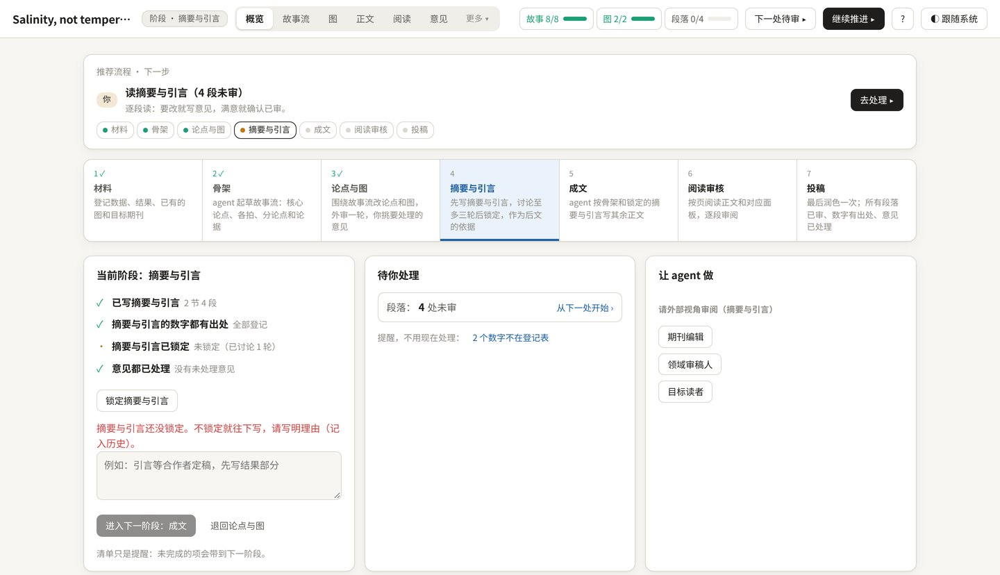
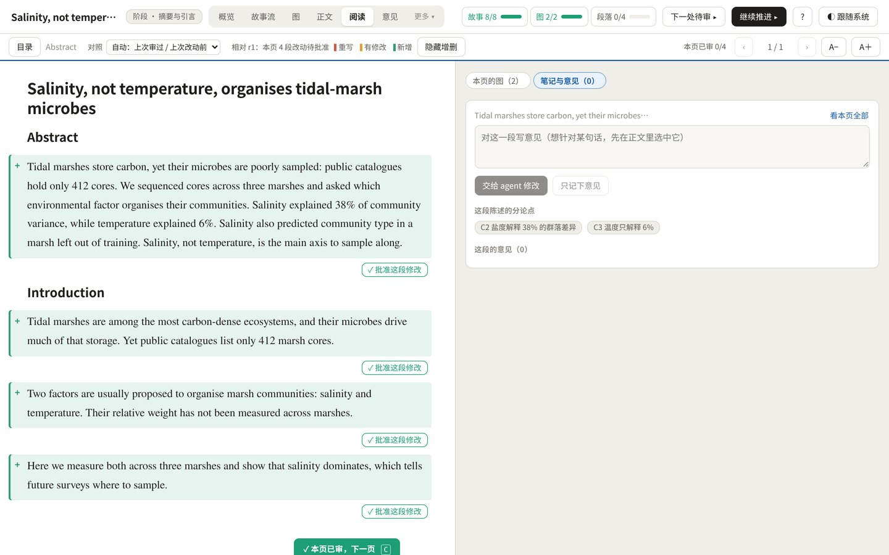
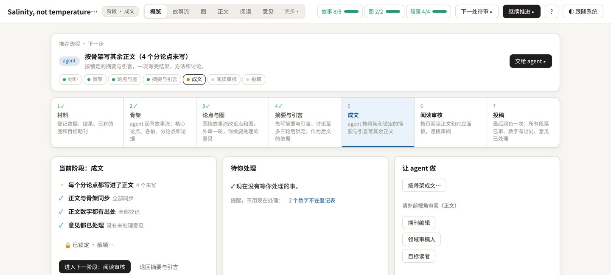

# Recommended way to use a paper project

English | [中文](workflow-guide.zh.md)

This guide shows the order we recommend for a paper project (project mode). It is a recommendation, **not a rule**: you can start at any stage, skip stages, or go back.

You do not need to remember the order. The project reads its own content, works out where the paper stands, and tells you the next step:

- click **「继续推进 ▸」 (Continue)** in the panel's top bar, or
- say "continue" in the conversation, or type `/paper-project-next`.

Both do the same thing. If the next step is the agent's, the agent does it. If it is yours, you are told where to do it in the panel; the agent never decides for you.

## In one sentence

**Settle the claims and figures first, then the abstract and introduction, and only then write the rest.** Each phase gets one combined outside review, and you pick which comments to act on from the full list. Polish the language once, at the end.

## The recommended order

| # | Stage | The agent | You | Done when |
|---|---|---|---|---|
| 1 | Materials | — | Register data, results, existing figures, target journal and readers | There are materials |
| 2 | Skeleton | Drafts the story flow: thesis, 5–9 beats, the claims and evidence of each beat | Read it; comment where you disagree | A thesis exists and every beat has claims |
| 3 | Claims and figures | Editor, reviewer and reader review the argument and figures **once** | Pick comments from the full list; fix core claims with weak evidence; place every figure; confirm each unit | Review comments triaged, core claims well supported, figures placed, all reviewed |
| 4 | Abstract and introduction | Writes them first; revises them from your comments | Read each paragraph, comment or confirm, then **lock** them | Locked |
| 5 | Draft | Writes results, methods and discussion in one go, against the skeleton and the locked abstract and introduction; sorts unregistered numbers | Check the unregistered numbers | Every claim is written up, prose in sync with the skeleton, every number has a source |
| 6 | Reading review | Editor, reviewer and reader read the prose **once** | Pick comments; read paragraph by paragraph beside the figure panels | Comments triaged, every paragraph reviewed, people's comments handled |
| 7 | Submit | One final language pass: wording only, numbers and claims unchanged | Accept or discard each rewrite; move to submit | Polished, stage set to submit |

Most of your time goes into three things: **settling the claims and figures, reading and locking the abstract and introduction, and reading the prose.** The agent can do the rest.

## Why this order

- **Claims before prose.** If the argument is not settled, every review round can tear the text down. Once it is settled, later changes stay local.
- **Abstract and introduction first, then locked.** They are the argument in prose: the problem, the gap, what was done and what was found. They are about one page, yet editors and reviewers read them most closely. Agree on them first, and the agent is much more likely to write the rest right the first time. After locking, any mismatch between them and the rest means the rest must change.
- **A cap on rounds.** The abstract and introduction invite endless revision. After three agent rounds, Continue suggests locking them and leaving the remaining comments for the prose review.
- **One outside review per phase, triaged by you.** Models raise many valid concerns, but are poor at picking the few that matter most. So the agent only raises them; you pick from the full list. Act on the comments that threaten a claim or that a real reviewer would raise, and decline the rest.
- **Every number has a source.** Each result number in the prose is in the registry with the file it came from. When data are re-run, you can see which paragraphs must change.
- **Polish last.** Drafts are still rewritten, so polishing them early is wasted work.

## How to use it

### The Continue button

*Screenshots use a fictional project; the panel is in Chinese.*

At the top of the overview is the **"Recommended workflow · next step"** card:

- On the left: who does the next step (the agent or you), what it is, and why.
- The button on the right:
  - **交给 agent**: hands the step to the agent in this conversation; the panel refreshes when it is done;
  - **去处理**: opens the place you need to act on: the comments page, a claim, the first unreviewed paragraph;
  - **锁定**: locks the abstract and introduction;
  - **进入**: moves to the next stage.
- Below it are the seven stages. A green dot means the stage's goal is met, and the current stage has an outline. Hover to see what is missing.

The top bar's **「继续推进 ▸」** does the same as the card's button, from any page.

**去处理** opens the first unreviewed abstract paragraph, where you comment or confirm, paragraph by paragraph:

Once they are locked and the stage is Draft, the next step goes to the agent: write the rest of the prose.

### In the conversation

Say "continue" or `/paper-project-next`. The agent first calls `project_status` to check progress:

- If the step is the agent's, it does it. It then checks again and goes on while the next step is still its own, for at most three steps in one turn.
- If the step is yours, it tells you in two or three sentences what to do and where, then stops.

The agent **never** confirms reviews, accepts rewrites, closes or declines comments, locks the abstract and introduction, or changes the stage.

### What always comes first

These come before anything else, and Continue moves on only once they are handled:

1. paragraph rewrites waiting for your decision;
2. comments the agent has answered, waiting for you to read;
3. paragraphs that no longer match their changed claims (the agent drafts rewrites);
4. comments written by people (author, collaborators, conversation, checks). These are instructions, and the agent acts on them.

## Starting midway

Continue looks for the first unfinished thing from **the stage you have set** onward. Earlier stages you skipped are listed under the card as "skipped (you may come back; not required)".

- **You already have a written manuscript.** Import it with "build a project from an existing manuscript". The project starts at Draft, so Continue begins with the prose's number and sync checks, then moves on to reading review, polish and submit. The argument review and the locked abstract and introduction are listed as skipped. To do them, go back to that stage in the overview.
- **You only want to review the prose.** Set the stage to Reading review and press Continue.
- **You want to rethink the claims.** Go back to Claims and figures. The prose is kept. Once a claim changes, paragraphs that no longer match are flagged in red, and the agent drafts rewrites for you to accept.
- The card may say **"by content, at X"**. This means that, checking from the start, the first stage whose goal is not met is X. It is only a hint; it never changes your stage.

## Locking and reasons

- **Locking the abstract and introduction.** Once they are locked, the agent cannot edit them directly. It can only propose rewrites, which you accept paragraph by paragraph. Rewrites you accept and your own edits keep the lock. To unlock, give a reason in the overview; it is recorded in the history.
- **Two moves need a written reason:**
  - leaving the Abstract and introduction stage without locking them;
  - entering Submit with checklist items still open.

  Both reasons are kept in the history. Every other checklist only advises. Jumping past Abstract and introduction from an earlier stage needs no reason.

## FAQ

**Must I follow this order?** No. Stages are yours to move; skip or go back at any time. Continue only says what the recommended next step is.

**Is the outside review only run once?** Continue recommends it once per phase: once for the claims and figures, once for the prose. You can still run it at any time with the three buttons under "Ask for an outside view" in the overview. To review with another model, switch the model in DSH and run them again; different models tend to miss different problems.

**Will the agent make up numbers?** It does not invent them. It may only use numbers from the registry. A missing analysis becomes a "gap" evidence item for you to decide on. Numbers in the prose that are not in the registry are highlighted.

**The abstract is locked, but it has to change.** Comment on that paragraph. The agent proposes a rewrite, and when you accept it the lock moves with it. For a large change, unlock with a reason.

## See also

- [Project mode](project-mode.zh.md) (Chinese): pages and agent tools in detail.
- [User guide](user-guide.md): manuscript review (reading, annotating, revising).
