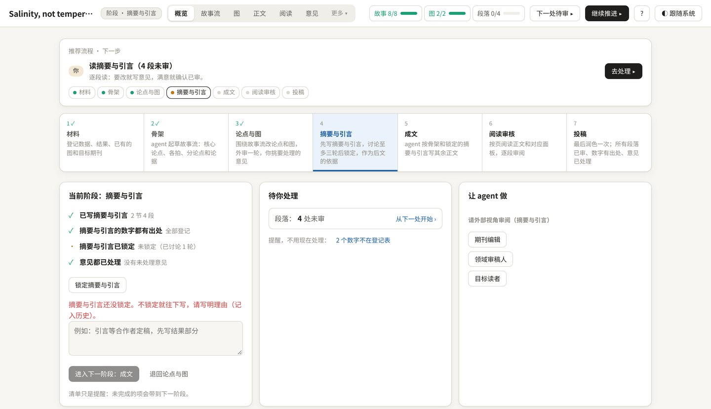
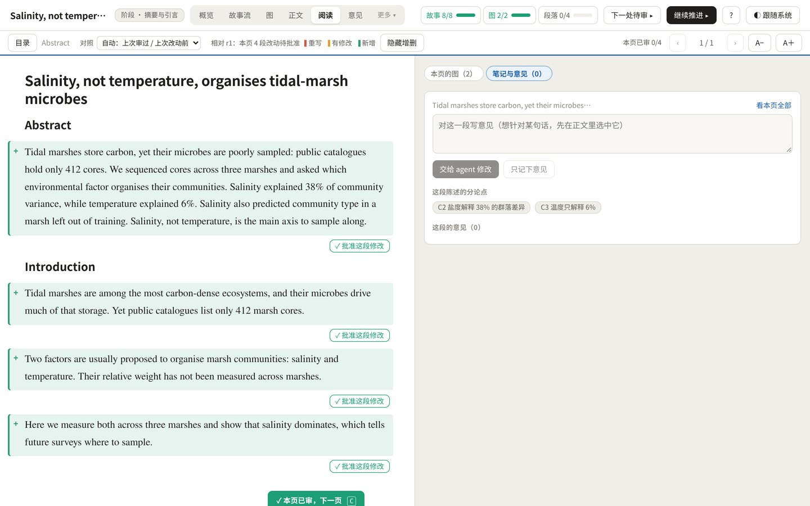
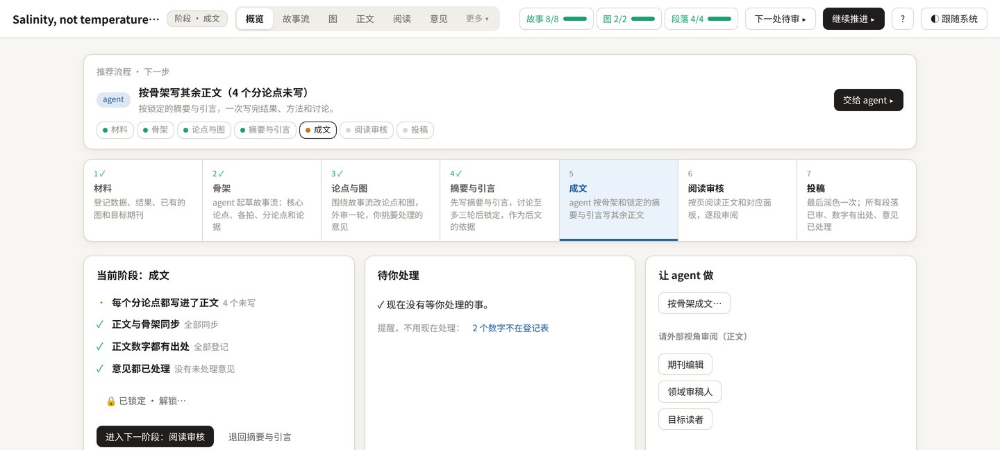

# 论文项目的推荐用法

[English](workflow-guide.md) | 中文

这份指南说说论文项目（项目模式）一般怎么用。下面推荐的这套顺序**并不强制**：你可以从任何阶段开写，也能随时跳过或退回。

这个顺序你也不用记。项目会自己看内容写到了哪一步，告诉你接下来干嘛：

- 点面板顶栏的 **「继续推进 ▸」**；
- 或者在对话里说“继续推进”，也可以输入 `/paper-project-next`。

两种用法效果一样。该 agent 干的活，它会直接去做；该你拿主意的，它会告诉你在面板哪里操作，不会替你拍板。

## 一句话版本

**先定论点和图，再定摘要和引言，最后才写剩下的正文。** 每个阶段集中请外部视角审一次，完整意见清单列出来后，由你挑哪些要改。最后再统一润色一次。

## 推荐流程

| # | 阶段 | agent 做什么 | 你做什么 | 达到什么算完成 |
|---|---|---|---|---|
| 1 | 材料 | — | 把数据、结果、已有的图，还有目标期刊和读者登记好 | 有材料 |
| 2 | 骨架 | 搭故事线：写出核心论点、5–9 拍，以及每拍的分论点和论据 | 通看一遍，不满意就写意见 | 有核心论点，每拍都有分论点 |
| 3 | 论点与图 | 请编辑、审稿人、读者**一次**把论点和图审完 | 从完整意见清单里挑要处理的；给证据不够的核心分论点补证据；定好每张图放主图还是扩展数据；逐个确认 | 外审意见都挑过了，核心分论点证据充足，图都有位置，全部已审 |
| 4 | 摘要与引言 | 先写出摘要和引言；再按你的意见改 | 一段段读，写意见或者确认；满意了就**锁定** | 已锁定 |
| 5 | 成文 | 照着骨架和锁定的摘要、引言，一次写完结果、方法、讨论；把没登记的数字分好类 | 核对没登记的数字 | 每个分论点都写进了正文，正文与骨架同步，数字都有出处 |
| 6 | 阅读审核 | 请编辑、审稿人、读者**一次**把正文读完 | 从清单里挑意见；对照面板一段段读 | 外审意见都挑过了，段落都审完了，人的意见也全处理了 |
| 7 | 投稿 | 最后润色一次：只改措辞，数字和论点不动 | 一段段决定接受还是放弃润色；进入投稿 | 已润色，已进入投稿 |

你的时间主要花在三件事上：**定好论点和图、读完并锁定摘要与引言、通读正文。** 剩下的事都可以交给 agent。

## 为什么这样排

- **先定论点，再写正文。** 论点没敲定就急着动笔，审一轮就可能推倒重来。先把论点和图定下来，后面的修改就只是小范围调整。
- **摘要和引言先写、先锁定。** 它们其实就是文字版的论点：问题是什么、缺什么、我们做了什么、发现了什么。虽然只有一页多，却是编辑和审稿人看得最细的地方。先把这儿聊透，后面照着它写，agent 一次写对的把握大得多。锁定以后，一旦正文和摘要、引言对不上，就说明要改的是正文。
- **讨论有上限。** 摘要和引言最容易一轮接一轮地改下去。agent 写或改满三轮后，“继续推进”就会建议你直接定稿锁定，剩下的意见留到正文外审时再处理。
- **外审每个阶段集中一次，由你来挑。** 让模型全面提意见，覆盖面还不错；但让它自己挑出“最重要的几条”，效果往往很差。所以只让 agent 提意见，由你从完整清单里挑：只处理威胁到分论点的、真审稿人会问的问题，其余直接标“不采纳”。
- **数字都要有出处。** 正文里的每个结果数字都要记在登记表里，写清来自哪个文件。以后数据重跑了，哪几段要跟着改一目了然。
- **润色放在最后。** 草稿前面还会被改写，太早润色等于白做。

## 怎么用

### 「继续推进」按钮

*截图使用虚构项目。*

概览页最上面是 **「推荐流程 · 下一步」** 卡片：

- 左边写着下一步由谁做（agent 还是你）、做什么、为什么。
- 右边的按钮：
  - **交给 agent**：把这一步交给当前对话里的 agent，做完后面板会自动刷新；
  - **去处理**：跳到面板里要你处理的地方，比如意见页、某个分论点、还没审的第一段；
  - **锁定**：锁定摘要与引言；
  - **进入**：把阶段推进到下一个。
- 下面一排是七个阶段：绿点说明这个阶段达标了，当前阶段会有边框。把鼠标放上去，就能看到还差什么。

顶栏的 **「继续推进 ▸」** 跟卡片上的按钮作用一样，在哪个页面都能点。

点「去处理」会直接打开第一段还没审的摘要，你可以逐段写意见，或者确认已审：

锁定并进入「成文」后，下一步就交给 agent 写其余正文：

### 在对话里用

说一句“继续推进”或输入 `/paper-project-next`。agent 会先调用 `project_status` 看一眼进度：

- 轮到 agent 的步骤，它直接动手。做完后会再查一次；要是下一步还轮到它，就接着做，一次最多连做三步。
- 轮到你的步骤，它会用两三句话告诉你去面板哪里做什么，然后停下来等你。

agent **不会**替你确认已审、接受改写、关闭或不采纳意见、锁定摘要与引言，也不会替你推进阶段。

### 你必须先处理的事

下面这几类事永远排在最前面，处理完了“继续推进”才会往下走：

1. 等你确认的段落改写；
2. agent 已经回应、等你过目的意见；
3. 论点改了之后对不上的段落（agent 会起草改写）；
4. 人写的意见（作者、协作者、对话、检查）。这些都是修改指令，agent 会去处理。

## 从中途开始

“继续推进”会从你**当前设定的阶段**开始，往后找第一件没做完的事。更早被跳过的阶段，会列在卡片下方，标为“跳过的阶段（可以回头补，不强制）”。

- **手头已经有写好的稿件**：用“从已有稿件建项目”导进来。导入后项目在「成文」阶段，“继续推进”会先检查正文的数字和同步情况，再去阅读审核、润色和投稿。前面的论点外审和摘要、引言锁定，会列为跳过的阶段。想补的话，去概览里退回到那个阶段就行。
- **只想审阅正文**：把阶段设到「阅读审核」，直接点“继续推进”。
- **想回头重定论点**：退回到「论点与图」。正文不会丢，论点改了以后，对不上的段落会标红，agent 会起草改写，由你来决定接受。
- 卡片右上角可能会显示 **“按内容判断在 X”**：意思是从头查起，第一个还没达标的阶段是 X。这只是个提示，不会自动改你的阶段。

## 锁定和写理由

- **锁定摘要与引言**：锁定以后，agent 就不能直接改这两部分了，只能提议改写，由你一段段接受。你接受的改写和你自己改的内容，都会自动保持锁定。要解锁的话，在概览里写明理由就行，理由会记入历史。
- **两处需要写理由**：
  - 在「摘要与引言」阶段，没锁定就往下走；
  - 清单没做完就进入「投稿」。

  这些理由都会记入历史。其他阶段的清单只是提醒。如果是从更早的阶段直接跳过「摘要与引言」，不需要写理由。

## 常见问题

**一定要按这个顺序吗？**
不用。这只是推荐顺序。阶段由你推进，随时都能跳过或退回；“继续推进”只是按推荐顺序，告诉你下一步该做什么。

**外审只能做一次吗？**
“继续推进”每个阶段只推荐一次外审：论点与图一次，正文一次。概览里“请外部视角审阅”那三个按钮随时都能再点。想换个模型再审一遍，在 DSH 里切换模型后再点就行。不同模型漏掉的问题往往不一样。

**agent 会编数字吗？**
不会去编。agent 只能用登记表里的数字。缺了的分析会记成“缺口”论据，交给你来定夺。正文里没登记的数字会标黄。

**摘要已经锁定了，后来发现必须改怎么办？**
直接在要改的那一段写意见。agent 会提议改写，你接受后锁定会跟着更新。要大改，就写明理由解锁。

## 相关文档

- [项目模式说明](project-mode.zh.md)：各个页面和 agent 工具的详细说明。
- [使用指南](user-guide.zh.md)：稿件审阅怎么用（阅读、批注与修改）。
